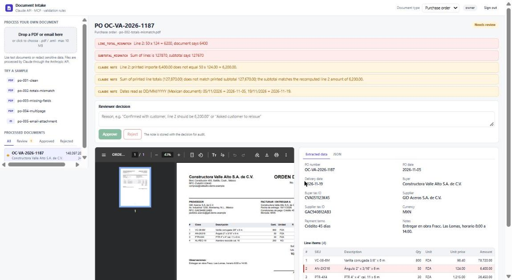
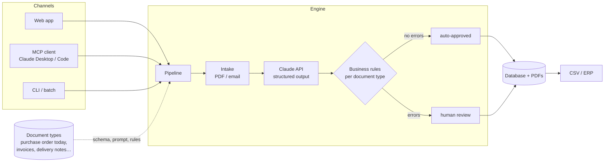

# Claude Document Intake: purchase-order pilot

Automated intake of purchase orders with the **Claude API** and an **MCP server**. A PDF or an email arrives, Claude extracts the order into validated JSON, business rules check it, and anything doubtful goes to a human review queue with the exact reason.

**▶ Live demo:** https://claude-document-intake-demo.onrender.com. The access code was shared with you privately. The first load can take up to a minute while the server wakes up.

---

## The problem

Order-entry teams retype purchase orders from PDFs and email attachments into the ERP. Every customer uses a different layout, language and date format. Retyping is slow, and the errors that matter, such as a wrong line amount or a resent duplicate order, are easy to miss.

## What the pilot does

1. **Intake.** A PDF, or an email with PDF attachments. The email body is kept as context.
2. **Extraction.** Claude reads the document (any layout, language or number of pages) into a strict schema: parties, PO number, dates, every line with product, quantity and price, and the totals. Missing data stays empty instead of being guessed.
3. **Validation in code.** Required fields, quantity × price on every line, subtotal, total with discount, tax and freight, dates, and duplicate orders.
4. **Routing.** Clean orders are approved automatically. Anything doubtful goes to a reviewer, who sees the original PDF next to the extracted data with the problem highlighted, and approves or rejects it with a note kept for audit.
5. **Output.** Database, CSV export (headers and lines) and a readable summary per order.

**Design principle: Claude extracts, code verifies.** Claude reads documents; it is not asked to do the arithmetic it is checked against. A mistyped amount on the document or a misread value both end up in review, never silently in the ERP.

## Three ways to use it

| Channel | For whom | What it looks like |
|---|---|---|
| **Web app** | Order-entry and review team | Upload or forward a document, review the queue, approve or reject |
| **MCP server** | Anyone using Claude (Desktop, Code, any MCP client) | *"Process this order"*, *"What's in the review queue?"*, *"Reject #12, the customer must reissue it"* |
| **CLI / batch** | IT / operations | Batch processing, CSV export, accuracy evaluation |

## Architecture

The engine is generic. Purchase orders are the first **document type** module; invoices, delivery notes, quotes and certificates plug in as new modules without changes to the web app, MCP tools or storage. See [the document-type contract](highlights/document-type-contract.ts).

## Results on the sample set

Live run with `claude-opus-5-5`:

| Document | What it tests | Fields correct | Cost | Time |
|---|---|---:|---:|---:|
| [po-001-clean.pdf](samples/po-001-clean.pdf) | English, USD, "November 3, 2026" dates | 26/26 | $0.030 | 6 s |
| [po-002-totals-mismatch.pdf](samples/po-002-totals-mismatch.pdf) | Spanish, MXN; line 2 printed as 6,400.00 instead of 50 × 124.00 | 30/30 | $0.041 | 15 s |
| [po-003-missing-fields.pdf](samples/po-003-missing-fields.pdf) | No PO number, no date, only "$" for currency | 22/22 | $0.028 | 8.5 s |
| [po-004-multipage.pdf](samples/po-004-multipage.pdf) | 2 pages, 35 lines, DD/MM dates, discount, VAT, freight | 154/154 | $0.097 | 23 s |
| [po-005-email-attachment.eml](samples/po-005-email-attachment.eml) | PO arriving as an email attachment | 22/22 | $0.028 | 7 s |
| **Total** | | **254/254** | **$0.22** | **avg 12 s** |

- **It reports what is printed, not what it thinks is right.** On po-002, Claude returned the wrong amount as printed, so the rules caught it. It also added its own note: *"printed subtotal is consistent with line 2 being 6,200.00"*.
- **It does not guess.** On po-003 it left the PO number, date and currency empty instead of inventing them.
- **About $0.03 per single-page order**, roughly $30 per 1,000 orders before batch discounts.

These are synthetic documents: they prove the flow, not production accuracy. The first step of a real engagement is measuring accuracy on your own documents.

## Code highlights

The full source is in a private repository. These excerpts show how it is built:

- [`highlights/document-type-contract.ts`](highlights/document-type-contract.ts): the contract that makes the engine generic.
- [`highlights/purchase-order-rules.ts`](highlights/purchase-order-rules.ts): the purchase-order business rules.
- [`highlights/mcp-tools.ts`](highlights/mcp-tools.ts): how the pipeline is exposed as MCP tools.

Stack: TypeScript / Node.js, Anthropic SDK (structured outputs), Model Context Protocol SDK, React, SQLite. There are automated tests for the rules, the pipeline, the MCP server and the web API (access control, client isolation, limits), and CI on every change.

## From pilot to production

1. **Your documents.** Measure accuracy on 30–50 real, anonymized purchase orders from your main customers, then tune the prompt and rules from those results.
2. **Master data.** Match customers, SKUs and price lists against your ERP.
3. **Intake channels.** A shared mailbox (Microsoft 365 / Outlook) or a SharePoint folder, instead of manual uploads.
4. **ERP integration.** Create sales orders automatically for approved documents.
5. **Single sign-on** (Microsoft Entra ID) and reviewer roles.
6. **Deployment** in your cloud, for example Azure. Claude is available on Microsoft Foundry.
7. **More document types**: invoices, delivery notes, quotes, certificates, plus automatic classification of incoming documents.

---

© 2026. All rights reserved. The excerpts in this repository are shared for evaluation only. No license is granted to use, copy, modify or distribute them.
